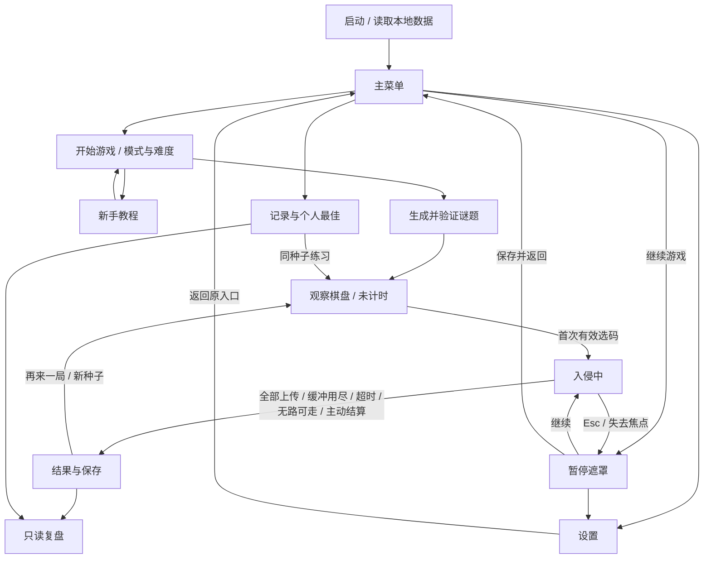

# 神经裂隙 · Neural Breach

> 游戏设计 v0.1 · 2026-10-23。首版已实现；具体运行方式见[入门指南](./getting-started.md)，实现与存储细节见[架构](./architecture.md)。本文同时保留原始视觉和音频目标，概念图不代表逐像素实现。

## 1. 游戏定位

基于当前 Go + MyGo 原生桌面框架，制作一款单机、离线、可反复挑战的黑客破解益智游戏。核心体验是「观察代码矩阵 → 规划行列路径 → 上传多个魔偶 → 查看成绩与复盘」。单局操作时间约 35–90 秒，观察阶段不限时。

视觉明确参考《赛博朋克 2077》的主菜单、设置菜单与入侵协议界面：黄色标题、珊瑚红菜单、青色选中条、黑红底色、切角边框、代码矩阵，以及短促的彩色故障闪烁。主菜单采用真正的游戏入口结构，游戏内采用终端式 HUD。

首版包括完整主菜单、四档难度、标准挑战、自由练习、新手教程、暂停、单槽续玩存档、成功/部分成功/失败结算、本地记录与复盘、音乐音效、故障动效及相关设置。每日挑战、剧情、装备成长、联网排行榜、联机和手柄支持留到后续版本。

## 2. 主菜单与完整流程

主菜单固定顺序：**开始游戏、继续游戏、查看记录、设置、退出游戏**。首次启动默认聚焦开始游戏；存在有效存档时默认聚焦继续游戏，但不改变菜单顺序。

| 入口     | 行为                                                           |
| -------- | -------------------------------------------------------------- |
| 开始游戏 | 进入模式与难度选择，点击「接入网络」后生成棋盘；首次可进入教程 |
| 继续游戏 | 读取当前未完成局，先进入遮罩暂停态，点击继续才恢复计时         |
| 查看记录 | 历史记录、按难度的个人最佳、选中记录详情和逐步复盘             |
| 设置     | 音频、画面、操作、语言与辅助功能                               |
| 退出游戏 | 无进行中游戏时直接退出；有游戏时执行保存并退出流程             |

没有存档时继续游戏保留位置、禁用并显示「暂无进行中的入侵」。存档损坏时显示「存档无法读取」和恢复入口，不伪装成没有存档，也不自动覆盖原文件。



图中的「设置返回」以调用入口为准：从暂停打开的设置必须返回暂停；观察阶段暂停后恢复观察，不启动计时。再来一局同样要先经过生成与验证。

## 3. 核心规则

### 3.1 棋盘与移动

1. 棋盘是 N×N 的十六进制代码矩阵，代码集合为 `1C / 55 / BD / E9 / 7A / FF`。
2. **第一步必须选择第一行。**进入棋盘时高亮第一行，允许无限观察；第一次有效选码后开始计时。
3. 选中一个格子，将其代码追加到缓冲区；接下来只能选这个格子所在列的其他未使用格子。
4. 下一步切换到新格子所在行，然后再切换到列。即「第一行 → 同列 → 同行 → 同列……」。
5. 同一个格子不能重复使用；不同格子上的相同代码可以再次选择。已用格子保留代码与步号，但禁止再次激活。
6. 点击非法格子不消耗缓冲、不扣额外时间，也不改变当前位置；给出轻量错误提示。计时自然继续。
7. 标准挑战不可撤销；自由练习可撤销到上一个合法状态，提示使用情况写入练习记录。

### 3.2 魔偶上传与序列重叠

每个魔偶对应一条有序代码序列。在缓冲区中出现该序列的**连续完整片段**即上传成功，不要求从缓冲区第一格开始，也不要求按目标列表顺序上传。已上传魔偶永久保留成功状态，每局只计一次。

多个序列允许共享代码。例如 `1C 55 BD` 与 `BD E9 7A` 可以通过 `1C 55 BD E9 7A` 同时上传，重叠的 `BD` 不必重复输入。

未完成目标的进度为「当前缓冲区后缀与目标前缀的最长匹配」，不能只在匹配失败时无条件清零。例如目标 `1C 1C 55`、输入 `1C 1C 1C` 后仍然匹配前两位。不能因为暂时不匹配就宣布该魔偶永久失败。

只展示「已上传 / 当前匹配 k/n / 等待」；首版不在实时界面展示依赖求解器才能确定的“已无解”标签。魔偶名称和描述提供叙事氛围，首版不改变棋盘、限时或倍率。

### 3.3 结束与结算

满足任一条件即结束：全部魔偶上传；缓冲区填满；时间到零；当前应选行/列不存在未使用格子；玩家点击「结束并结算」并确认。

结果分三类：全部上传、部分上传（至少一个）、入侵失败（零个）。提前结算保留已完成目标的基础分；暂停退出与保存返回不结算。放弃旧局另开新局需要确认，并记录为「已放弃」，不进入最佳榜。

有效输入处理顺序固定：检查剩余时间是否大于零 → 验证格子 → 追加代码 → 匹配全部目标 → 检查全部完成 → 检查缓冲区/合法动作。最后一格同时完成全部目标时按全部上传结算；已经超时的点击无效。

### 3.4 一条可验证的完整路径

以下矩阵与主战斗图、结算图使用同一个示例。坐标从 1 开始。

```text
     C1 C2 C3 C4 C5 C6
R1   55 1C E9 BD 7A FF
R2   BD E9 55 1C FF FF
R3   7A 55 FF E9 BD 1C
R4   FF BD 1C 55 E9 7A
R5   E9 FF 7A 1C E9 BD
R6   1C 7A BD FF 55 E9
```

路径：`(1,2) → (3,2) → (3,5) → (5,5) → (5,3) → (2,3) → (2,6)`。

缓冲：`1C 55 BD E9 7A 55 FF`。目标分别为数据虹吸 `1C 55 BD`、监控静默 `BD E9 7A`、痕迹抹除 `7A 55 FF`，均为 3 位。第 3 步后，缓冲区为 `1C 55 BD`，下一步应高亮第 5 列，数据虹吸已上传、监控静默匹配 1/3。

## 4. 模式与难度

| 难度 | 矩阵 | 缓冲容量 | 魔偶数 | 单条序列长度 | 操作限时 | 倍率 | 全上传最短路径目标 |
| ---- | ---- | -------- | ------ | ------------ | -------- | ---- | ------------------ |
| 入门 | 5×5  | 7        | 2      | 3            | 90 秒    | ×1.0 | 5–6 步             |
| 标准 | 6×6  | 8        | 3      | 3–4          | 60 秒    | ×1.5 | 6–7 步             |
| 困难 | 7×7  | 9        | 3      | 4–5          | 45 秒    | ×2.0 | 8–9 步             |
| 极限 | 8×8  | 10       | 4      | 4–6          | 35 秒    | ×3.0 | 10 步              |

这些是首轮调优参数，需通过实际游玩校准。难度来自路径规划、序列重叠、可用缓冲和时间压力，不靠降低文字清晰度、随机遮挡代码或强制频闪。

标准挑战使用新随机种子、固定规则，无提示和撤销，参与对应难度的个人最佳。自由练习可输入种子、选择不限时、请求下一步提示、撤销和重试；保存练习记录，但不进入标准挑战最佳榜。教程使用固定脚本关卡，不参与成绩统计。

观察不限时是有意保留的体验；时间奖励衡量**开始选码后的执行速度**，不是完整解题速度。暂停/续玩允许保留标准成绩并记录恢复次数，首版是个人离线挑战，不宣称具备竞技防作弊能力。同种子主动重玩始终进入练习。

### 谜题生成约束

先生成不重复格子的合法路径，再沿路径构造有重叠的目标序列，最后填充干扰代码。求解器必须确认存在容量以内的全上传方案，而不是分别验证每个目标能完成就算通过。

生成后校验序列不重复、不过度包含其他目标、最短全上传路径落在该难度范围内。采用版本化确定性随机生成器；同一生成器版本、种子、难度产生相同谜题。限定搜索预算并支持取消；超出预算时使用预先验证的对应难度题库，不能把未验证谜题交给玩家。调整难度参数时同步调整规则版本。

## 5. 分数、记录与复盘

设已上传魔偶数为 k，总数为 n，已上传目标长度为 Lᵢ，缓冲容量为 B，已用格数为 U，总限时为 T，剩余时间为 R（使用毫秒精度），难度倍率为 M：

```text
魔偶基础分 = 100 × ΣLᵢ
多目标奖励 = 150 × max(k − 1, 0)
全部上传奖励 = k = n 时 400，否则 0
时间奖励 = k = n 时 floor(300 × R / T)，否则 0
缓冲节约奖励 = k = n 时 80 × (B − U)，否则 0
总分 = floor((以上五项之和) × M)
```

零目标完成得 0 分。时间与节约奖励只在全部完成时发放，避免通过尽早放弃刷奖励。倍率使用整数分子/分母计算，最终统一向下取整。练习不限时的时间奖励为零，界面明确显示「练习分」。

**贯穿设计图的示例：**标准难度，三个 3 位目标全部完成，用 7/8 格，24 秒完成（剩 36/60 秒）：`(900 + 300 + 400 + 180 + 80) × 1.5 = 2,790`。同一谜题完成两个目标但未全上传为 `(600 + 150) × 1.5 = 1,125`。

历史按时间倒序，支持模式、难度、结果筛选。个人最佳以模式、难度、规则版本分组，依次比较得分高、上传数多、已用格少、操作时间短；仍相同时保留较早记录。统计已完成局数、全上传率、最高分，不把教程、练习、未完成和已放弃局混入标准挑战统计。

每局存储：唯一局 ID、模式、难度、种子、规则/生成器版本、棋盘及目标快照、开始/完成时间、逐步坐标与有效操作耗时、已上传目标、结束原因、分项得分、恢复次数、辅助使用标记。保存实际棋盘快照，避免未来生成器升级导致旧复盘改变。

复盘是只读棋盘，可上一步、下一步、播放、暂停；同步显示合法行列、缓冲和目标进度。默认展示玩家实际路径，可切换展示一条已验证的全上传路径。复盘不修改成绩，从复盘重试进入自由练习。导出 JSON 保存完整记录，CSV 用于成绩摘要。无记录时显示「完成第一次入侵后，记录会出现在这里」及开始游戏入口。

## 6. 续玩、暂停和退出

首版一个进行中存档槽，标准挑战、自由练习和教程共用。进入新棋盘、每次有效选码、暂停、返回主菜单、退出时触发保存。继续时恢复棋盘、坐标、已用格、缓冲、目标状态、模式、规则版本、已消耗操作时间与音乐阶段；不把离线时间计入限时。教程续玩保留教学步骤和不限时规则，完成或放弃后清空槽位，不写入成绩历史。

Esc、失焦和最小化都进入暂停，使用不透明遮罩隐藏棋盘与目标，停止计时和输入。焦点恢复后停留暂停页，不自动继续。保存并返回主菜单保留存档；重新开始转为同种子练习，并先确认结束当前局。

进行中退出显示「当前入侵进度将保存。下次可从主菜单继续」，提供取消与保存并退出。系统关闭按钮与菜单退出共享同一逻辑。写入失败时保留内存游戏，显示「重试保存 / 取消退出 / 不保存退出」；最后一项必须再次明确确认。

存档和历史由同一个版本化游戏数据仓库管理，原子写入同一快照：结算时同时加入局 ID 对应的记录并清除活动局，防止重启重复入账。后台写队列串行化，带单调 revision，旧快照不得覆盖新快照。只有持久化成功后显示「已保存」；失败保留待写状态。窗口关闭等待最后一次保存，损坏数据或未知版本阻止覆盖并提供备份/修复流程。

## 7. 界面规格

基准画布 1440×900，优先支持 1280×720 到 1920×1080，最小窗口 1100×700；高 DPI 按逻辑尺寸布局。8×8 棋盘在最小窗口下仍须保持每格至少 44×44，代码和缓冲不裁切；右侧目标面板可滚动，棋盘不滚动。正文 16–18，代码 24–32，主菜单 28–36，标题 40–64。提供 100%/125%/150% 文本缩放，高缩放时允许增加窗口最小尺寸或使用纵向布局。

| 界面     | 主要内容与交互                                                              |
| -------- | --------------------------------------------------------------------------- |
| 主菜单   | 左侧纵向五项菜单，右侧低亮度赛博终端背景；显示续玩摘要                      |
| 开始游戏 | 标准挑战/自由练习；四档纵向难度项；右侧解释矩阵、缓冲、限时、倍率；接入网络 |
| 入侵界面 | 左上倒计时，右上缓冲；左下矩阵，右下魔偶；底部操作提示与主动结算            |
| 暂停     | 继续、保存并返回主菜单、设置、重新开始、退出；棋盘与目标完全遮挡            |
| 结算     | 结果、分数、上传数、耗时、分项计算、保存状态；再来一局、复盘、返回          |
| 记录     | 筛选与历史表格、个人最佳、右侧详情；复盘、种子练习和导出                    |
| 设置     | 音频、画面、操作、语言与辅助；从游戏打开时维持暂停                          |
| 教程     | 四个交互步骤：首行、行列交替、连续匹配、序列重叠；不限时                    |
| 状态变体 | 失败结算、保存退出确认；生成失败可重试，存档失败可恢复，空记录可开局        |

主菜单方向键选择、Enter 确认、Esc 返回。棋盘方向键移动焦点，Enter/Space 选码，Tab 在主要区域切换；非法焦点不触发选择。选码使用按下边沿，长按确认不得连续提交；鼠标双击同格不提交两次。M 切换全局静音。音量滑块、列表和返回按钮均需清晰键盘焦点。

### 色彩与视觉语法

| Token          | 色值      | 用途                           |
| -------------- | --------- | ------------------------------ |
| Terminal black | `#100C10` | 黑红背景和暂停遮罩             |
| Panel red      | `#211219` | 面板层次与低亮度底图           |
| Signal red     | `#F25B64` | 普通菜单、框线、警告和失败     |
| Breach yellow  | `#FCEE09` | 标题、代码、剩余时间、主操作   |
| Link cyan      | `#75F0E7` | 当前选中、成功、匹配进度与焦点 |
| Text ivory     | `#E6DDE1` | 正文和辅助说明                 |

字体按原作研究修订：英文 UI 和代码采用 Rajdhani 500，标题和倒计时采用 600，正文采用 400；代码使用固定宽度格子对齐，Rajdhani 本身不是等宽字体。中文以文鼎 UD 晶熙黑体为还原目标，菜单使用中等字重、说明文字使用常规字重，不机械压窄中文。目前可运行预览仅嵌入真实 Rajdhani，中文明确标注为系统黑体回退；晶熙黑的应用嵌入字体资源待正式取得。字体证据、来源置信度及版本范围见[字体核查与修订](./design/neural-breach/typography.md)。Logo 可以倾斜破碎，正文不得故障化。颜色之外同时用边框、步号、勾叉和状态文字表达含义。

## 8. 音乐与音效

音乐是首版功能。方向为原创工业电子、暗色合成器、低频脉冲与金属打击，不使用原作现成录音。先制作可无缝循环的曲目及分层素材；音频预览中的合成器仅验证氛围和切换，不是最终混音。

| 状态        | 音乐方向                                     | 行为                                   |
| ----------- | -------------------------------------------- | -------------------------------------- |
| 主菜单      | 80–90 BPM 的低密度 drone、细碎颗粒、稀疏脉冲 | 低音量循环，首开淡入                   |
| 观察棋盘    | 保留氛围底层，弱化鼓点                       | 不暗示时间已经开始                     |
| 入侵中      | 约 100 BPM 的低音序列、工业节拍              | 首次选码后加入节奏层                   |
| 剩余 ≤10 秒 | 同一拍速增加高频脉冲与打击密度               | 不突然换曲或提高总体响度；仅进入一次   |
| 上传成功    | 80–180 ms 的短促数字确认音                   | 叠在音乐上，不每上传一个就重启整段音乐 |
| 全部上传    | 1–2 秒上行确认短句                           | 之后转为安静的结算氛围                 |
| 失败        | 200–500 ms 的低频断连/颗粒坍缩               | 短暂留白后进入结算氛围                 |
| 暂停/后台   | 200–300 ms 淡出                              | 默认后台静音，恢复时从音乐相位平滑淡入 |

多层音乐共享采样时钟，按小节或短交叉淡化切换，避免直接加速整首曲目造成音高变化。音效包括焦点移动、选码、无效输入、魔偶上传、全上传、失败、存档和故障短噪声。同帧多个目标完成合并成功提示音；无效点击音限流。输入音不能因读取文件或解码而延迟。

设置提供总音量、音乐音量、音效音量、动态音乐、后台静音、试听、M 静音。默认音量暂定 80/65/85（百分比），最终按响度测试调整。静音不丢失原音量；滑块变化即时预览，返回时取消未应用变化，应用后持久化。动态音乐关闭时播放稳定的基本循环，不影响计时或成绩。

原生实现使用 MyGo `audio`；复用 `mayoi`/`farm` 的事件驱动声音思路。预加载短音效，音乐资源加载放在后台；音频设备不可用时保持可玩并显示可恢复状态。窗口关闭释放播放器，页面切换不得叠加创建多条背景音乐。

## 9. 彩色碎片故障动画（Glitch）

目标是用户描述的「稀碎的彩色动画一闪而过」：横向图像切片短暂错位、红/青通道分离、少量黄/紫数字碎片、细线扫描和瞬时噪点。静止时界面清晰，动效仅在有意义的事件触发。

| 触发              | 时长建议             | 表现                                         |
| ----------------- | -------------------- | -------------------------------------------- |
| 启动 Logo         | 350–500 ms，单次     | 2–3 段局部切片错位，迅速收敛成清晰标题       |
| 菜单确认/页面切换 | 120–180 ms           | 细窄红青碎片扫过边缘，不闪白全屏             |
| 魔偶上传          | 100–160 ms           | 仅对应目标行及外框出现彩色短片，勾号稳定保留 |
| 全上传            | 220–300 ms           | 外框短暂青色重组，然后展示结算               |
| 失败/断连         | 250–350 ms           | 红色断层和少量彩色像素脱落，不连续重复       |
| 最后 10 秒        | 默认只有边缘缓慢脉冲 | 倒计时保持静态清晰；高频闪烁默认关闭         |

每次突发仅 1–2 个亮度脉冲，相邻突发至少间隔 1.5 秒；更密集的上传事件合并或仅播放勾号反馈。低强度位移 2–4 像素，中 4–8，高 8–12；首版默认低。彩色碎片通常覆盖画面不超过 5%，失败最高不超过 10%，不覆盖正在选择的代码与目标文字。不持续循环全屏闪光。

设置：关闭/低/中/高、减少动态效果、低时间闪烁。减少动态效果覆盖其他动效开关，关闭通道分离、抖动、闪烁和扫描，用静态颜色与勾号替代；游戏功能和得分完全相同。视觉故障噪声归音效总线，可单独随音效音量降低。

实现可以使用 MyGo Painter 的裁剪/平移叠层；确需后处理时参考官方 `examples/wind` 与 `examples/chat-glow` 的 shader 思路。先用轻量叠层达成效果，不把故障效果做成整个游戏状态的随机重排。所有动画不得影响碰撞区、选择判定或倒计时。

## 10. MyGo 实现映射

设计时已核对 **MyGo v0.6.2** 源码。该版本包含 `plugins/game`、`examples/mayoi`、`examples/farm` 和音频示例，足以支撑本设计。项目当前依赖为 v0.10.0，以 `go.mod` 锁定的源码为准。

| 项目部分                     | 建议职责                                       |
| ---------------------------- | ---------------------------------------------- |
| 根目录 window/view/menu      | 游戏页面、共享导航与命令、主线程状态更新       |
| `internal/game`（拟新增）    | 纯规则状态机、合法动作、序列匹配、结算与评分   |
| `internal/puzzle`（拟新增）  | 确定性生成器、求解器、题库与种子解析           |
| `internal/records`（拟新增） | 历史、活动存档、版本校验、原子提交与复盘数据   |
| `internal/sound`（拟新增）   | 音乐状态、音量、短音效与资源生命周期           |
| 现有 config/storage/tasks    | 配置验证、原子写入、后台任务取消与防止过期回调 |
| `resources/audio`（拟新增）  | 原创/可分发的循环音乐、分层素材与音效          |
| locales                      | 延续现有五种语言和生成访问器                   |

菜单、设置、历史用原生 `ui.View`；棋盘优先采用带可访问标签和焦点的原生元素，Painter 负责切角与装饰。动画场景可用 `game.View`，但不要将所有交互藏在没有语义的画布里。使用 `mayoi` 的输入边沿、焦点暂停及声音事件处理作参考，保留当前窗口和任务管理边界。

`game.View` 默认固定步长 60 Hz，源码存在最大追帧限制。因此**不能用已执行帧数直接当限时**：以可注入的单调时钟累计前台有效游戏时间，排除明确的暂停区间；前台卡顿仍消耗时间。失焦事件直接暂停，恢复时重设计时基点。求解与存盘不得阻塞 UI；视图构建不得触发 I/O。

## 11. 实现阶段与验收

1. 规则核心：路径合法性、序列重叠、终止顺序、可解生成、精确评分；使用上面的完整路径作为规则验收样例。
2. 可玩闭环：主菜单、难度、观察/计时、键鼠输入、暂停、三类结算；先验证 8×8 最小窗口可用。
3. 数据：保存继续、关闭退出、历史、个人最佳、复盘；验证失败恢复、版本升级和结算幂等性。
4. 视听：主题、背景、音乐分层、短音效、Glitch、减弱动态效果和五语言适配。
5. 桌面验收：macOS/Windows/Linux 的窗口、焦点、音频、文件路径和打包资源；通过项目已有 Go 检查、竞态检查、MyGo vet 与 UI 快照。

关键验收包括：首行限制；非法点击不落子；格子不复用；缓冲连续匹配与重叠；最后一格成功优先；超时点击无效；暂停不泄露棋盘；恢复不扣离线时间；返回设置保持暂停；成绩只保存一次；损坏记录不被覆盖；静音不叠音；减少动态效果后仍能看清所有状态。

## 12. 本次设计交付与参考

[界面图目录与索引](./design/neural-breach/README.md)包含 8 张主要界面图、1 张状态变体图板、生成提示词和可打开的视听动效预览。图片为视觉概念稿，细小装饰数字、字体和像素位置不作为实现规格；棋盘、格数、评分、交互与状态以本文为准。

- [MyGo game 官方文档](https://mygo.egoist.dev/docs/plugins/game)：游戏循环、输入、绘制和游戏示例入口。
- [MyGo v0.6.2 mayoi 示例](https://github.com/egoist/mygo/blob/v0.6.2/examples/mayoi/main.go)：本地已检查相同版本的暂停、输入及声音组织。
- [MyGo v0.6.2 farm 示例](https://github.com/egoist/mygo/blob/v0.6.2/examples/farm/main.go)：本地已检查相同版本的键鼠、音乐与绘制组织。
- [PC Gamer：Breach Protocol 玩法介绍](https://www.pcgamer.com/how-to-cyberpunk-2077-hacking-breach-protocol/)：参考原作行列交替和序列规划的玩法。
- [原作主菜单截图参考](https://www.mobygames.com/game/128136/cyberpunk-2077/screenshots/playstation-5/1086881/)与[破解界面截图参考](https://jkchen2.gitlab.io/cpah/development/)：参考菜单和终端的布局、色彩与视觉层次。

难度参数、计分、存档、音乐触发和故障时长是本项目提案，不声称是原作数值。当前实现使用固定的 MyGo v0.10.0 依赖。

## 13. 首版实现说明

生成器以最短公共超串下界加合法完整路径证明可解性与难度范围；无需在生成阶段穷举所有棋盘路径。音乐采用实时原创合成声部，共享采样时钟，菜单也使用稳定的 100 BPM 基础时钟，仅降低节奏层；未内嵌录音素材。故障效果采用事件触发的边缘彩色碎片，不对整个界面进行后处理切片。已上传状态与分项成绩从实际步骤重算，不重复存储。默认中文，字体使用 Rajdhani 与系统 CJK 回退。界面只有专门设计的深色终端主题。
